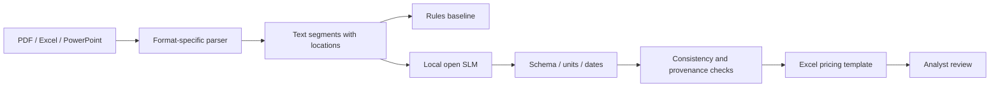
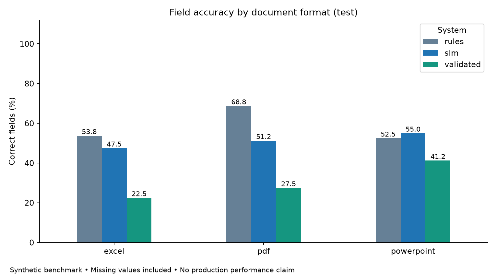
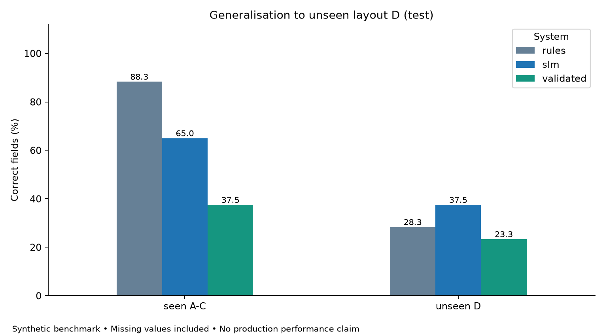
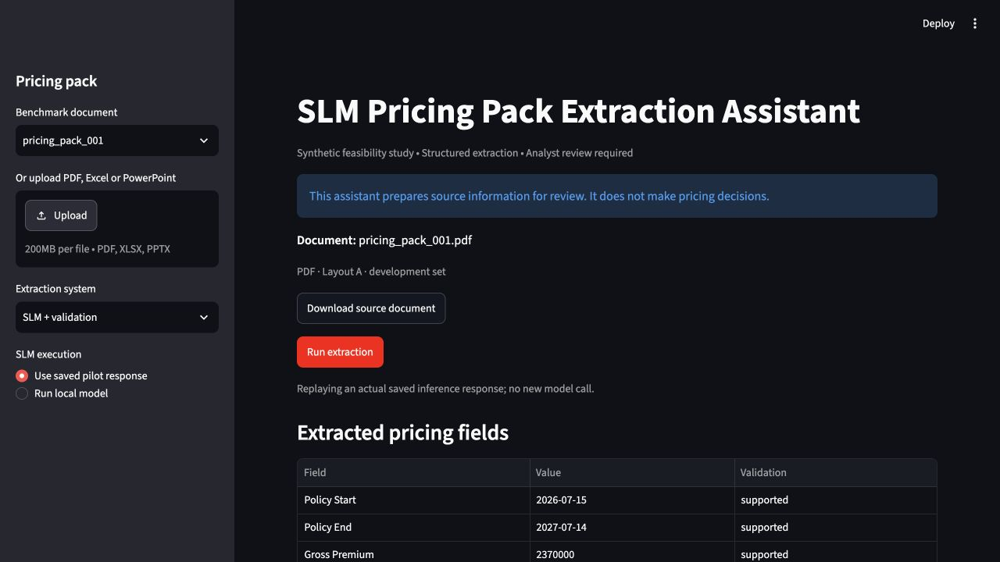

# SLM Pricing Pack Extraction Assistant

A reproducible feasibility experiment for extracting eight UK insurance pricing fields from PDF, Excel and PowerPoint into an analyst review template.

**All documents are synthetic. No confidential insurer data are used. The system does not make pricing decisions. An analyst remains responsible for final review.** This is a research internship prototype, not an official Tech Mahindra product or a production insurance system.

## Problem

Pricing analysts receive portfolio information in tables, spreadsheets, slides and narrative summaries. They manually transfer premium, claims, dates, rate changes and limits into standard templates. Differences in terminology, layout and units make this repetitive work error-prone.

## Research question

Can a small language model reliably extract standard pricing fields from heterogeneous documents, particularly layouts excluded from development? The pilot tests extraction accuracy, missing information, layout generalisation, deterministic validation and source provenance. Rules are a serious comparator; there is no assumption that the SLM should win.

## Business workflow and architecture



Ground truth is used only by document generation and evaluation. The SLM sees format and source segments, without document IDs, layout labels, split labels or answers. Validation never repairs a result using ground truth.

## Synthetic dataset and document generation

Fixed seed **20260930**, 60 independent pricing packs: 20 PDFs, 20 Excel workbooks and 20 PowerPoint decks. Each format includes all four layout families:

| Layout | Construction | Use |
|---|---|---|
| A | Label/value tables | Development and seen test |
| B | Narrative sentences | Development and seen test |
| C | Multiple sections; Excel uses separate sheets | Development and seen test |
| D | Reordered dashboard, reversed columns, value-first callouts | Unseen test only |

Documents use GBP symbols and codes, full pounds, thousands and millions, signed percentages and percentage words, ISO and UK dates. Excel includes typed numeric/date values and percentage formats. Some records explicitly contain zero claims/losses, some omit fields, and some supply only month/year dates. Exact dates without a day have null ground truth. Generated values have sufficient displayed precision to reconstruct their truth.

The public labels are in `data/ground_truth/records.json`. They are intentionally accessible for research inspection, but excluded from extraction inputs. Regeneration creates missing documents only before freezing. Once frozen, the evaluator refuses changed or missing benchmark files; restore them from Git instead of silently changing the benchmark.

## Target pricing fields

Exactly eight fields: `policy_start`, `policy_end`, `gross_premium_gbp`, `claim_count`, `incurred_claims_gbp`, `rate_change_pct`, `aggregate_limit_gbp`, `occurrence_limit_gbp`.

Dates use `YYYY-MM-DD`, currency is GBP, rates use percentage points (`7.5` means `7.5%`), and counts are integers. Missing information is `null`, never guessed or replaced by zero. Each field carries `value`, `source_text` and `source_location`.

## Parsers

- **PDF:** PyMuPDF extracts text in page reading order, including simple table text, with page provenance. No OCR or dedicated table reconstruction.
- **Excel:** openpyxl reads values and coordinates, reconstructs formatted percentages and GBP amounts, and retains row-level cell ranges. Uncached formulas cause an explicit failure instead of disappearing.
- **PowerPoint:** python-pptx reads text boxes and table rows with slide/shape/table locations. Image-only text and nested groups are outside this pilot.

The shared representation is a list of `{location, text}` segments. Excel row ranges and PDF pages are intentionally coarser than exact semantic cell/span attribution; locations are not fabricated.

## Extraction systems

1. **Rules:** fixed keywords, common synonyms and nearby value matching. No test-specific layout rules.
2. **SLM:** local Qwen2.5-1.5B-Instruct, 1,543,714,304 parameters, pinned revision `989aa7980e4cf806f80c7fef2b1adb7bc71aa306`. Zero-shot, greedy decoding, no fine-tuning. CPU, Apple MPS and CUDA are supported; the backend chooses an available device.
3. **SLM + validation:** uses the exact same SLM response as system 2, then applies deterministic checks. This isolates validation's effect from model sampling.

The raw schema accepts unit-bearing strings, but all eight fields and all evidence keys are mandatory; extra fields, booleans and non-finite values are rejected. Invalid output gets one retry. All responses, retries and failures are retained in `results/audit.jsonl`. A failed extraction is never reported as a successful null prediction.

## Validation

Pydantic schema checking; full-expression numeric parsing; UK/ISO full-date parsing; non-negative count/currency warnings; policy ordering and occurrence/aggregate consistency warnings; quote-and-location presence; and a conservative check that the returned number/date appears in its quote.

Unsupported values become null with traceable reasons. Logical inconsistencies are flagged rather than silently corrected. Whitespace/case-normalised quote matching is **not semantic proof**: the wrong field can cite a real amount, and a correct value can be rejected if the model paraphrases or mislocates its evidence. Validation can reduce extraction coverage substantially.

## Benchmark design

30 development documents and 30 test documents. Test has 15 seen A–C and 15 unseen D, with equal format counts. There are no duplicated underlying records across formats/splits. Layout D has no prompt/few-shot examples. The engineer necessarily knows its generator; “unseen” means excluded from development, not an independently sourced external distribution.

The full [research protocol](docs/research_protocol.md) specifies leakage controls and denominators. `data/frozen_benchmark/manifest.json` contains SHA-256 hashes. Results record model revision, hardware, prompt hash and source hashes. Do not tune on this test set; create a new benchmark version for future research iterations.

## Evaluation metrics

Field accuracy includes all eight fields and true nulls. Numeric/date exact match is measured on non-null truth after the same valid normalisation for every system. Missing accuracy and unsupported-field rate use null-truth fields. Provenance support uses non-null predictions. Document complete accuracy requires all eight decisions to be correct. Available-fields document accuracy and failure rates are also reported.

Failed documents count every field as incorrect, including null truth. Unsupported-field rate measures only predictions on absent/insufficient fields, not every hallucination. Always inspect it alongside failures and extraction coverage. Headline results are **test only**; development results remain separately available in CSVs.

## Preliminary results

<!-- RESULTS_START -->
Actual held-out test results: 30 documents, 240 fields per system. Full dataset: 66 null field labels across 45 documents.

| system | field_accuracy | numeric_exact_match | missing_field_accuracy | unsupported_field_rate | provenance_support_rate | document_complete_accuracy |
| --- | --- | --- | --- | --- | --- | --- |
| rules | 58.3% | 52.6% | 100.0% | 0.0% | 100.0% | 30.0% |
| slm | 51.2% | 47.4% | 51.4% | 35.1% | 38.1% | 10.0% |
| validated | 30.4% | 19.2% | 83.8% | 2.7% | 100.0% | 3.3% |

Across the full 60-document run, 9 SLM documents failed both attempts. Failed fields count as incorrect; see failure-rate columns and the report. Validation improved 13 field decisions and worsened 161 across development plus test. No result was replaced with a fabricated success.
<!-- RESULTS_END -->



## Seen vs unseen layouts



See [the pilot report](docs/pilot_report.md) for denominators, format/layout tables, successful examples, failures, validation tradeoffs and research interpretation. Poor results are retained.

## Demo



```bash
streamlit run app/streamlit_app.py
```

Choose a source document or upload a PDF/XLSX/PPTX, select a system and run extraction. Review the field table, quoted text, locations and validation audit. **Use saved pilot response** replays a recorded real SLM response; **Run local model** performs new inference. Uploaded files always require live inference for SLM modes. The demo labels recorded failures and incomplete runs.

The displayed layout/split label is for the reviewer only. It is never sent to the model. For a fast walkthrough choose `pricing_pack_001`, use SLM + validation and saved-response mode, then populate the pricing template.

## Excel template

`template/pricing_template.xlsx` contains the eight fields, source and validation columns. Exports always use validated values; nulls remain blank, zeros remain zero, rates are stored as Excel percentages, and dates are typed dates. No pricing formula or underwriting recommendation is produced. Source text is explicitly stored as text to avoid accidental spreadsheet formulas.

## How to run

Python 3.12+ recommended. The recorded local run used Python 3.14, Apple M1 Pro, 16 GB memory and MPS. A first model download needs internet and approximately 3 GB of weights; CPU execution can be substantially slower.

```bash
git clone https://github.com/Peanut-butter116/insurance-pricing-pack-extractor.git
cd insurance-pricing-pack-extractor
python3 -m venv .venv
source .venv/bin/activate
pip install -r requirements.txt
python -m pytest -q
python -m evaluation.run_pilot
streamlit run app/streamlit_app.py
```

The experiment command generates missing unfrozen data, freezes/verifies the benchmark, parses documents, runs all systems, writes predictions/audits/metrics/charts and creates the template. It returns a non-zero exit code if any extraction failed, **after saving the full results**. That is a recorded research outcome, not permission to substitute fabricated output.

For the exact recorded package versions on compatible hardware use `pip install -r requirements-lock.txt`. Greedy decoding does not guarantee bitwise equality across devices or library versions. PDF/container metadata can change generated file bytes; the committed documents and manifest are the canonical reproducible benchmark.

```bash
python -m data.generate_documents
python -m evaluation.run_pilot --system rules --output results/rules_only
python -m evaluation.run_pilot --system slm --split test --output results/slm_only
MODEL_ID=Qwen/Qwen2.5-3B-Instruct python -m evaluation.run_pilot --output results/qwen3b
SLM_DEVICE=cpu python -m evaluation.run_pilot --split development --limit 2 --output results/smoke
```

Use a separate `--output` directory for alternative systems/models or smoke tests so they do not overwrite the published pilot. Environment variables are read from the shell; `.env.example` is documentation and is not automatically loaded. Set `MODEL_REVISION` to pin alternate models. `HF_HUB_OFFLINE=1` uses an existing model cache. `--system validated` runs the SLM once and reports its validated output.

## Repository structure

```text
data/          seeded records, document generators, 60 documents and hash manifest
parsers/       PDF, Excel and PowerPoint adapters
extraction/    rules, SLM backend, prompt, schemas and validated pipeline
validation/    numeric/date/schema/consistency/provenance checks
evaluation/    frozen benchmark, experiment runner, metrics and charts
template/      blank Excel template and population code
app/           Streamlit analyst review demo
results/       measured predictions, tables, charts, metadata and raw audit
tests/         parser, validation, model-contract, metric and template checks
docs/          research protocol and pilot report
```

## Limitations

Synthetic language and layouts are much simpler than real broker packs. The sample is small; only eight fields are tested. No pricing analyst study, confidential data, OCR, complex embedded objects or production security validation is included. Reading order and spreadsheet formatting are potential parser artefacts. Evidence presence does not prove semantic faithfulness. These results do not establish production performance, insurer-level generalisation, or statistical superiority.

## Next steps

For a 12-week study: obtain authorised, de-identified packs and analyst requirements; build a larger external frozen benchmark; compare stronger rules with 1.5B/3B/7B models; improve constrained JSON generation and evidence grounding; measure latency and review effort; then investigate OCR/multimodal parsing. Consider QLoRA only after identifying a persistent, measurable failure mode and separating training/development/test data.
